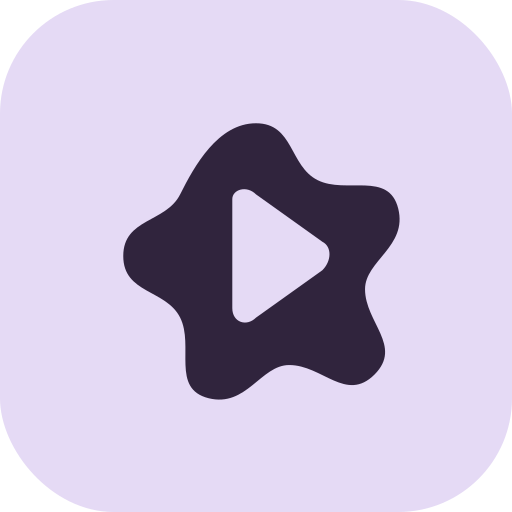
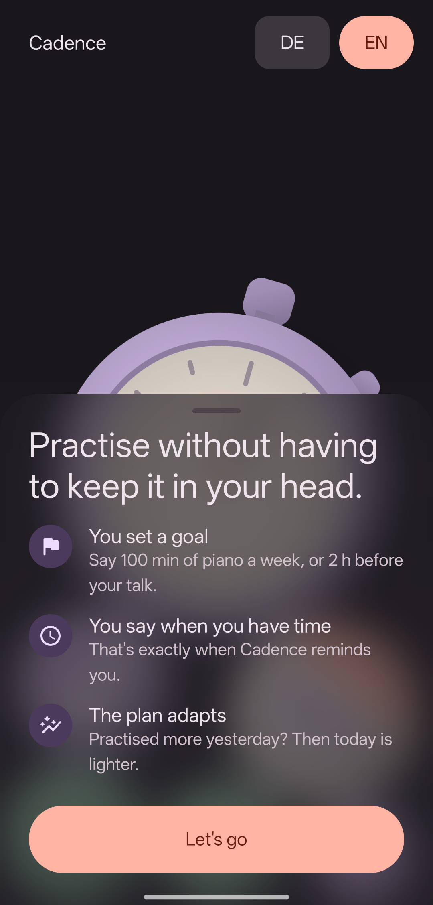
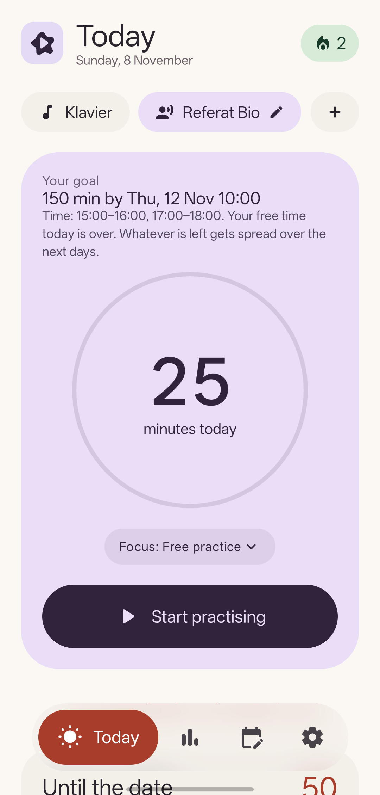
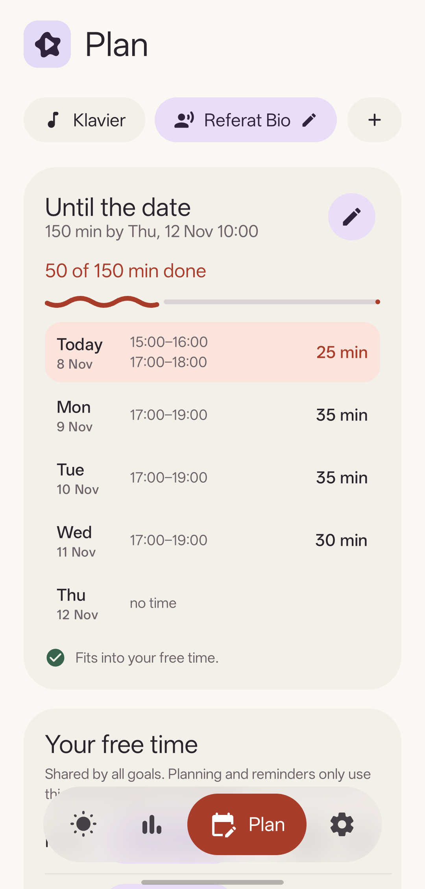
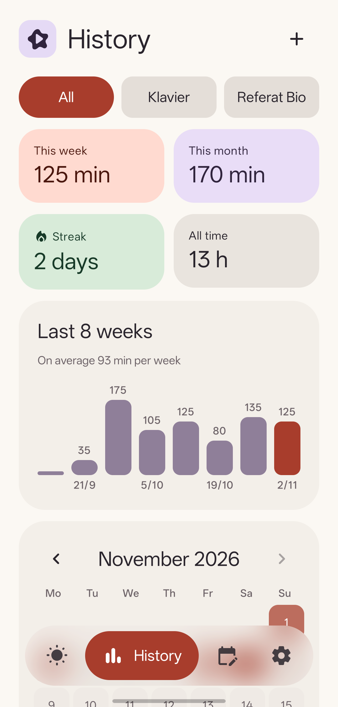
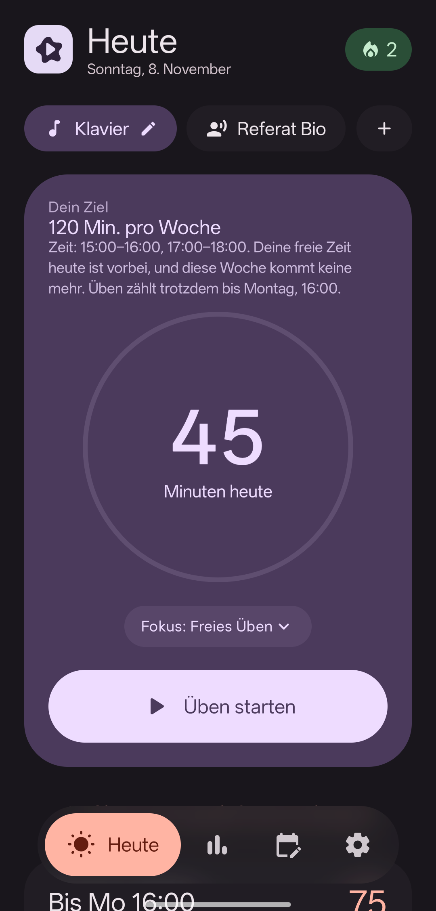

<p align="center">
  
</p>

<h1 align="center">Cadence</h1>

<p align="center">
  <b>Practise regularly without keeping it all in your head.</b><br>
  For an instrument, a talk, an exam or any other skill.
</p>

<p align="center">
  
  
  
  
  
</p>

<p align="center">
  
  
  
  
  
</p>

## How it works

1. **Set a goal.** Either a weekly amount (100 minutes of piano a week) or a total by a date (two hours before Thursday's talk at 10:00).
2. **Say when you have time.** One or more free slots per weekday, shared by all goals.
3. **Practise what's due today.** Cadence spreads the goal over your free time and shows each day's share as a ring that fills while the timer runs.

## Features

- **A plan that adapts.** Extra practice makes the next days lighter, sometimes a day becomes free. Missed days are spread over what's left instead of piling onto one day. A new goal only asks for the share of free time left in its first week.
- **Weeks that start at a lesson.** A weekly goal can reset at, say, Monday 16:00; practice before the lesson still counts for the week before.
- **Reminders when it fits.** When a free slot starts, or at the time you usually begin once Cadence has seen a few timed sessions. One follow-up in the last slot while there is still enough time. Nothing once today is done, on days without free time, while a timer runs or within an hour of practice. After three ignored days it drops to one a day until you practise again. On a day you've earned off, an optional note says so.
- **A setup that gets everything right at the start.** Five short steps, one question each, several goals in one go, with a plan preview. Behind it, matte objects lie on the floor of the screen and follow real gravity when you tilt the phone.
- **Timer** that survives closing the app, with progress towards today's goal in its notification (Android 16 progress style; Live Update requested where the system supports it).
- **History** with stats, an 8-week chart and a month calendar. The streak skips days without free time, so planned rest never breaks it.
- **Small celebrations** for finishing today, reaching a goal and streak milestones, with short haptic patterns.
- **Widget** in four sizes that follows the app's light or dark theme.
- German and English, light/dark/wallpaper colours, Material 3 time and date pickers, notes and CSV export.

No account, ads or remote backend. Android system backup may include app data when enabled.

## Build

Open `android/` in Android Studio, or use Java 21 and the included Gradle wrapper:

```sh
cd android
./gradlew :app:assembleRelease
./gradlew :app:testQaUnitTest :app:lintDebug
```

The app supports Android 10 and newer and targets Android 16. Release builds are unsigned; signing keys are kept outside the repository. The `qa` variant has a separate application ID so tests do not reset the main app's data.

## Repository

- `android/`: native Android app and tests.
- `Übezeit-Tracker/` and `Übezeit-Tracker.xcodeproj/`: preserved original iOS project.
- `fastlane/metadata/android/`: English and German store descriptions and screenshots.
